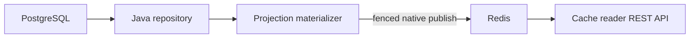

# rest-sample-cache-writer

## Version 0.8.1

Published sample 0.8.1 uses REST/platform 4.8.1, cache 0.9.1 and model 0.5.1. It includes
the ARM provenance packaging fix without changing business logic or native ABIs.
Use the aligned 0.8.1 artifacts; earlier 0.8.0 release notes remain historical.
[Patch notes](docs/RELEASE_NOTES_v0.8.1.md).

[English](README.md) | [Türkçe](README.tr.md)

## Compose

**Unpublished source workflow.** This topology and the new helper-based examples
below require coordinated checkout changes, not the published sample `0.8.1` alone.
Matching REST/platform, cache and Dubbo source dependencies must already be installed
or resolvable. `--prepare` / `-Prepare` packages the samples; it does not build those
framework dependencies. New JNI exports also need matching REST native resources;
existing ABI numbers are unchanged. Kubernetes validation is not Compose-engine
execution proof, and this recipe does not establish ARM hardware qualification.

The shared topology lives in sibling `rest-sample-cache-reader/docker/compose/`.
See the [full Compose guide](https://github.com/esasmer-dou/rest-sample-cache-reader/blob/master/README.md#compose).
Keep all four sample checkouts under one parent with their repository names.
Use Linux/amd64 Docker Engine, Compose v2 with `--wait`, JDK 21/Maven and resolvable
aligned dependencies. Bash needs `curl`, `jq`, `timeout`; PowerShell needs version 7.
From this repository's root:

```bash
bash ../rest-sample-cache-reader/scripts/verify-compose-topology.sh --prepare
# Alternative: catalog-only native provider + native-static-consumer
bash ../rest-sample-cache-reader/scripts/verify-compose-topology.sh --prepare --native-provider
```

PowerShell: `pwsh -File ../rest-sample-cache-reader/scripts/verify-compose-topology.ps1 -Prepare`
(add `-NativeProvider` for the alternative). Preparation packages all four samples
with tests skipped and copies runtime dependencies. Each of PostgreSQL with seed,
Redis 7, writer, reader, provider and consumer has 1 CPU / 128 MiB limits; apps use
OpenJ9 Java 21/JNI. Reader is at `127.0.0.1:18081`, consumer at `127.0.0.1:18082`.
Writer has no HTTP API; health requires live fenced projection pointers in Redis.

Full smoke sends POST/PATCH through consumer/provider to PostgreSQL, then checks
writer-to-fenced-Redis-to-reader convergence and consumer DB reads. Native mode
requires the sibling ABI-3 native resources described in the guide and pairs
`native-provider` with `native-static-consumer`. It checks catalog RPC and the same
cache pipeline using direct SQL mutations; it does **not** support customer command
or DB RPC. This writer's responsibilities are unchanged in either mode.

Both modes check five bounded RSS samples; evidence is in the shared parent's
`.tmp/wp3-*`. Default cleanup removes only that unique smoke stack/volume;
`--keep` / `-Keep` retains it. Inspect `containers.log` and `result.properties` on
failure. This idiomatic application separates SQL, mapping and fenced publication;
it is not a minimal benchmark fixture. The single-DB/Redis demo is not HA, and
configured limits do not prove runtime RSS, sustained throughput or p99 acceptance.

## Start With 0.8.1

Projection jobs reuse prepared JSON field names and bounded JDBC/Redis work. Per-projection schedules, locks, fencing and TTL safety remain intact. The writer still owns DB-to-Redis publication, not REST reads.

[Usage guide](docs/functional-operations.md) · [Release notes](docs/RELEASE_NOTES_v0.8.1.md)


Feature, run and error map: [Usage examples](docs/functional-operations.md).

A small scheduled application that reads PostgreSQL and publishes ready JSON snapshots to Redis.

- Java owns SQL, business mapping, and scheduling decisions.
- Rust owns Redis I/O through `java-rust-cache`.
- The process does not expose a REST API.
- The process does not use Dubbo.
- Each projection has its own schedule, TTL, and distributed lock.

Current versions: `rust-java-platform-parent:4.8.1`, `java-rust-cache:0.9.1`, `rust-sample-model:0.5.1`.

## Read This First

Choose this sample when one scheduled process owns PostgreSQL-to-Redis materialization. Do not add a
REST server or a Redis read plane to this process unless it has a separate measured responsibility.

| Goal | Go to |
| --- | --- |
| Run PostgreSQL, Redis, and one publish | [Quick Start](#quick-start) |
| Understand TTL, refresh, and lock safety | [Schedule, TTL, and Lock](#schedule-ttl-and-lock) |
| Choose standalone, Sentinel, or Cluster | [Redis Topology](#redis-topology) |
| Run more than one replica | [Multiple Replicas](#multiple-replicas) |
| Understand the agent boundary | [Glowroot Agent Use](#glowroot-agent-use) |

The POM uses `rust-java-platform-parent` and one `rust-java-starter-cache-writer` dependency. This
starter intentionally does not pull the REST runtime into the scheduled writer process. Code
generators stay on the compiler path and are not packaged as production classes.

## Current Checkout

This update aligns the platform with REST `4.8.1` and optional agent `0.7.1`.
Use the native file packaged with the dependency you selected. Do not mix older SO/DLL files.
Business code, URLs and configuration keys stay the same. Telemetry remains disabled by default.
The HTTP micro memory gate does not guarantee the same overhead for a database job or a richer profile.

Version `0.8.1` uses platform parent `4.8.1`. Rebuild the application with the aligned
dependencies. See [release notes](docs/RELEASE_NOTES_v0.8.1.md). Runtime settings and URLs are unchanged.

- The managed writer launcher creates and closes the PostgreSQL resource in one lifecycle.
- Generated projection registry wiring replaces repeated projection lookup code.
- SQL queries and JSON business mapping remain explicit Java code.
- Projection names, refresh intervals, TTL rules, locks, and Redis keys are unchanged.
- The cache writer verifies Redis ABI `6` and its packaged SHA-256. It does not start a REST runtime.

## Declarative Flow

| You write | Generated or managed for you | Not created in this process |
| --- | --- | --- |
| SQL and batch repository | Repository lifecycle and shutdown order | REST server |
| Projection materializer | Projection registry and schedules | Redis read pool |
| JSON business shape | Bounded publish pipeline | Dubbo runtime |
| Per-projection interval, TTL, and lock | Scheduler and fenced lock ownership | Duplicate schedule wiring |

The framework removes lifecycle and registry boilerplate. SQL, data selection, and JSON business
shape remain explicit Java code so the cache contract stays reviewable.

## Start Here

Use this sample when REST pods should read prepared data instead of querying PostgreSQL on every request.

A projection is a cache view prepared for one endpoint group, such as customer detail or campaign candidates.

```text
PostgreSQL -> this writer -> Redis -> cache reader -> HTTP client
```



## Quick Start

### 1. Start PostgreSQL and Redis

Run from PowerShell:

```powershell
docker rm -f rs-cache-postgres-test rs-cache-redis-test 2>$null

docker run -d --name rs-cache-postgres-test `
  -e POSTGRES_DB=reactor_sample `
  -e POSTGRES_USER=reactor `
  -e POSTGRES_PASSWORD=reactor `
  -p 15432:5432 postgres:15.7-alpine

docker run -d --name rs-cache-redis-test `
  -p 16379:6379 redis:8.2.1-alpine3.22
```

### 2. Publish one snapshot

Run from this repository:

```powershell
$env:GITHUB_PACKAGES_TOKEN="YOUR_TOKEN_WITH_READ_PACKAGES"

mvn -q `
  "-Dsample.writer.run-once=true" `
  "-Dsample.writer.initial-delay-ms=0" `
  "-Dsample.db.jdbc-url=jdbc:postgresql://127.0.0.1:15432/reactor_sample" `
  "-Dsample.db.username=reactor" `
  "-Dsample.db.password=reactor" `
  "-Dreactor.cache.redis.host=127.0.0.1" `
  "-Dreactor.cache.redis.port=16379" `
  clean compile exec:java
```

Expected log:

```text
cache refresh published projection=detail version=<version> keys=<count>
```

### 3. Read the data

Start [`rest-sample-cache-reader`](https://github.com/esasmer-dou/rest-sample-cache-reader). The reader uses the same Redis instance.

## What Is Published

| Projection | Default namespace | Typical use |
|---|---|---|
| `detail` | `crm.customer.detail` | Customer profile |
| `segment` | `crm.customer.segment` | Customers in a segment |
| `status` | `crm.customer.status` | Active or passive customer list |
| `campaign` | `crm.customer.campaign` | Campaign candidates |
| `meta` | `crm.customer.meta` | Snapshot status and version |

Activate only the projections you need:

```properties
sample.writer.projections=detail,segment,status,campaign,meta
```

For example, a campaign-only process can use:

```properties
sample.writer.projections=campaign,meta
```

## Schedule, TTL, and Lock

Released sample `0.8.0` enables `reactor.cache.redis.snapshot-batch-enabled=true`
with cache `0.9.0`. The library's own default is still off. On standalone Redis and
Sentinel, a matching native library completes a small refresh in two Redis write
calls: acquire the lease and fencing token, then write the
last batch, publish its version and release the lease. Cluster keeps the existing
slot-aware path. Older native libraries keep the existing path as well.
Keys, TTL, owner checks and fencing are preserved. Larger snapshots still flush
bounded batches; a tail above 1 MiB uses the ordinary batch writer. The final
publish verifies the remote lock owner, not just a local flag. Ambiguous network
failures are not silently replayed. No extra worker or retained payload pool is added.

To use the legacy publication path, set `REACTOR_CACHE_REDIS_SNAPSHOT_BATCH_ENABLED=false`.
The SQL reads and published JSON stay the same. The difference is five Redis write
calls instead of two for a small refresh. Measure the end-to-end job duration in
your deployment; fewer calls do not guarantee a specific p99.

The matching native library uses `EVALSHA` for these two fixed scripts. This caches
the Lua program in Redis, not customer data or SQL results. A missing script
uses `EVAL` once; subsequent calls send its digest. Explicit denial of the
`EVALSHA` command also keeps the existing `EVAL` path. Timeouts and Lua runtime
errors are not replayed. `snapshot_script_cache_misses` and
`snapshot_script_acl_fallbacks` in cache metrics show these fallback cases.
Wire bytes include the additional cold-cache commands; `write_calls` counts
the two logical write operations, not individual script-cache retries.


Segment and status refreshes use a bounded grouped query per projection. Complete
results up to 64 rows use a single autocommit SELECT;
larger results keep the database cursor after a bounded probe.
The query limits the group count and the number of customers in each group.
Only the current group is mapped into Java objects. This avoids one extra query per segment
or status. Detail refreshes still use ID-based pages. JSON shapes, TTL, replica
locks and atomic snapshot publication are unchanged.

The `meta` projection reads counts, segment names and status names in one SQL
statement. These values share the same database snapshot. The limits remain 64
segment names and 32 status names. Blank names are removed after those limits,
as before. JDBC arrays and the connection are released after the read. No extra
pool, thread, cache or property is needed. Redis leases and fencing remain in
place: this reduces database round trips, not consistency checks.

Every projection is independent.

```properties
sample.writer.campaign.interval-ms=30000
sample.writer.campaign.cache-ttl-ms=120000
sample.writer.campaign.lock-name=crm.customer.campaign.refresh
sample.writer.campaign.lock-ttl-ms=120000
```

This means:

1. With default fixed-delay scheduling, the next campaign attempt starts 30 seconds after completion.
2. The published Redis data has a 120-second TTL; this is not a reader freshness limit.
3. A 120-second Redis lease protects publication, with owner/fencing checks against stale writers.
4. Another replica may refresh a different projection at the same time.

Keep cache TTL longer than the interval, expected build/outage time and safety margin.
Only a TTL at or below the interval is raised to interval plus
`sample.writer.cache-ttl-safety-margin-ms` and logged; that minimum is not an outage guarantee.
Lock TTL is separate: it is not a job timeout. Size it for the complete refresh and
network margin; expired work can still compute, but cannot publish under a stale lease.

## Redis Topology

| Environment | Set |
|---|---|
| Local Redis | `reactor.cache.redis.topology=standalone` |
| Redis Sentinel | `reactor.cache.redis.topology=sentinel` plus Sentinel nodes and master name |
| Redis Cluster | `reactor.cache.redis.topology=cluster` plus cluster nodes |

The writer is intentionally write-only:

```properties
reactor.cache.redis.access-mode=write-only
```

## Small Linux/OpenJ9 Pods

You can test `-XX:-TransparentHugePage` as an optional Linux/OpenJ9 setting. It is
not enabled by default in this sample image. With it, OpenJ9 no longer asks Linux
to promote its allocations to huge pages. This can reduce resident memory without
reducing the heap limit or disabling JIT. It is not a heap cap and does not change
the node's global settings. Native allocations can still use huge pages.

Do not copy a consumer's memory setting to the writer without testing it.
The writer has a different compilation and refresh workload. This option can
also increase peak RSS; keep it only if repeated refresh tests show a benefit.

Overriding `JAVA_TOOL_OPTIONS` replaces the image's entire value. For the existing
small-pod image, keep these options together:

```yaml
env:
  - name: JAVA_TOOL_OPTIONS
    value: >-
      -Xms24m -Xmx96m -Xss192k -Xgc:threads=1
      -XX:ActiveProcessorCount=1 -Xtune:virtualized -XX:-TransparentHugePage
```

This recipe is for OpenJ9. Scheduler threads, refresh intervals, Redis batches,
TTL and Hikari limits are unchanged. Compare refresh duration and RSS over the
same number of successful refreshes. Lower RSS is not a gain if publishing slows
down or misses its interval.

## Configuration

The application reads configuration in this order:

1. `src/main/resources/rest-sample-cache-writer.properties`
2. Files passed through `reactor.config.file` or `REACTOR_CONFIG_FILE`
3. JVM `-D...` values and supported environment variables

| File | Purpose |
|---|---|
| `rest-sample-cache-writer.properties` | Local DB, scheduler, projection, lock, and Redis defaults |
| `config/production.properties` | Production HikariCP limits, TTLs, and Redis timeouts |
| `config/advanced-tuning.properties` | Larger batches, projection-specific locks, and Redis pipeline tuning |

Use the production overlay:

```powershell
java "-Dreactor.config.file=src/main/resources/config/production.properties" ...
```

Important starting values:

| Property | Start with | Change when |
|---|---:|---|
| `sample.db.maximum-pool-size` | `2` | DB wait is high and PostgreSQL has capacity |
| `sample.writer.scheduler-threads` | `2` | Independent projections cannot finish on time |
| `sample.writer.page-size` | `500` | Measure DB latency and heap before increasing |
| `reactor.cache.redis.write-connections` | `2` | Redis write queue is the measured bottleneck |
| `reactor.cache.redis.max-write-inflight` | `4` | Increase only with Redis capacity evidence |

Do not increase all limits together. That hides the real bottleneck and increases RSS.

## Glowroot Agent Use

The default build adds no agent dependency. Business logic and existing settings stay unchanged.
Choose the optional `glowroot` Maven profile when this process needs telemetry.

```powershell
$env:REACTOR_GLOWROOT_ENABLED="true"
$env:REACTOR_GLOWROOT_PROFILE="micro"
$env:REACTOR_GLOWROOT_COLLECTOR_ADDRESS="http://127.0.0.1:8181"
$env:REACTOR_GLOWROOT_AGENT_ID="cache-writer-local"
mvn -Pglowroot clean compile exec:java
```

The profile adds `java-rust-glowroot-cache-adapter:0.7.1`.
`TelemetryCacheWriterApplication` uses the existing writer lifecycle. Projection names come from current settings. Select transaction type `Scheduler`, name `cache-refresh:<projection>` in Collector UI.

No Spring or REST server is added. Enabled telemetry uses the isolated Rust exporter.
No Java executor is created. Payloads, SQL values and customer data are not sent.
A normal lock skip is not an error. Failed results and exceptions count as errors. Writes are not retried.

Set `REACTOR_GLOWROOT_ENABLED=false` to turn telemetry off.
Build without the `glowroot` profile to remove its dependencies as well.
Adding the bootstrap JAR alone does not start this lifecycle.

Add a server with id `github-glowroot` to Maven `settings.xml`.
Use a valid `read:packages` token. SSH does not download Maven packages.
Start with `micro`. The HTTP gate's 3 MiB steady paired-median bound is not
a per-load memory guarantee for this application.

[Setup and profile details](https://github.com/esasmer-dou/java-rust-glowroot-agent/blob/v0.7.1/docs/functional-operations.md)

## Multiple Replicas

Multiple replicas are supported.

- The scheduler avoids overlapping scheduled runs of one projection in this process; Redis leases coordinate replicas.
- Publication checks the current lock owner/fencing token. Lease expiry can overlap computation, not authorize stale publication.
- Different projections can run concurrently within the configured scheduler and connection limits.
- Normal completion releases the lease early. After a crash, another replica may acquire it on its next attempt after expiry.

Use a stable, different `lock-name` for every projection, identical across replicas
of that projection. Reader and writer projection namespaces must also match.

## Code Map

| File | Why it matters |
|---|---|
| `RestSampleCacheWriterApplication.java` | Starts the projection scheduler |
| `CustomerCacheMaterializer.java` | Implements the projection refresher; generated registry connects each projection |
| `PostgresCustomerRepository.java` | Owns SQL and database paging |
| `CustomerJsonWriter.java` | Writes JSON without an extra Java object tree |
| `rest-sample-cache-writer.properties` | Local settings |

The application uses the managed four-argument `ProjectionWriterApplication.runCache(...)` overload.
Two method references create the repository and materializer. The library owns Redis, scheduler,
repository, and shutdown order. SQL queries and JSON business shape remain explicit Java code.

## Maven Package Access

GitHub Packages requires a token with `read:packages`. The token also needs access to the private `rust-sample-model` repository.

Add these server IDs to `~/.m2/settings.xml`:

```xml
<servers>
  <server>
    <id>github</id>
    <username>YOUR_GITHUB_USERNAME</username>
    <password>${env.GITHUB_PACKAGES_TOKEN}</password>
  </server>
  <server>
    <id>github-rust-sample-model</id>
    <username>YOUR_GITHUB_USERNAME</username>
    <password>${env.GITHUB_PACKAGES_TOKEN}</password>
  </server>
</servers>
```

## Common Problems

| Symptom | Check |
|---|---|
| Maven returns `401` | Token, private repository access, and server IDs |
| Writer cannot connect to PostgreSQL | JDBC URL, port, username, and password |
| Reader sees old or missing data | Projection namespace, refresh interval, TTL, and writer logs |
| Two replicas publish the same data | Projection lock names must match across replicas |
| Redis memory grows too quickly | Reduce retained versions, TTLs, index limits, or active projections |
| `reactor.glowroot.enabled=true` produces no data | Build/run with `-Pglowroot` so `TelemetryCacheWriterApplication` and the cache adapter are included; check collector/agent ID. This headless process has no REST diagnostics endpoint |

## Production Checklist

- Keep `reactor.cache.redis.access-mode=write-only`.
- Keep every TTL longer than its projection refresh interval.
- Give every independently scheduled projection a stable, unique lock name.
- Keep SQL paging and batch size bounded; do not load the full source table into one list.
- Size Hikari connections from database capacity, not scheduler thread count.
- Make publish idempotent and use fenced ownership before moving the active snapshot version.
- Test two replicas, lock handover, Redis restart/failover, DB timeout, partial publish, and recovery.
- Measure publish duration, schedule lag, DB pool wait, Redis p99, RSS, and retained versions.
- Do not add Spring Boot or the REST runtime only for telemetry.

## Frequent Refreshes Without Schedule Drift

The source repository declares a bounded group-query plan for segment and status
reads. A complete result of at most 64 rows uses one autocommit SELECT. A larger
result uses the original streaming cursor; probe rows are never published or
combined with that cursor snapshot. No database result cache is introduced.
The probe adds one bounded read on overflow. For workloads that routinely exceed
the bound, use the original string-SQL `forEachQueryGroup` overload directly.
Java still owns validation, JSON generation and the Redis fenced publication.

For short refresh intervals, `sample.writer.phase-anchored=true` keeps the initial
spacing between projections. The default `false` waits a full interval after each
job finishes; different job durations can gradually bring jobs together.

```properties
sample.writer.phase-anchored=true
sample.writer.interval-ms=500
sample.writer.detail.initial-delay-ms=2000
sample.writer.segment.initial-delay-ms=2100
sample.writer.status.initial-delay-ms=2200
sample.writer.campaign.initial-delay-ms=2300
sample.writer.meta.initial-delay-ms=2400
```

Missed time slots are skipped, not replayed. Jobs still use the configured thread
limit and projection locks. No thread or queue is added. Keep TTL longer than the
interval, expected job/outage duration and safety margin. Keep the default when
your job needs a full quiet interval after completion. This setting changes
scheduling, not the DB rows, JSON content or publication consistency.

This opt-in option is not a p99 fix or a new production default. Measure
your job duration separately before enabling it.

## Glossary

| Term | Meaning |
| --- | --- |
| Projection | A cache view prepared for one endpoint or query family |
| Refresh interval | How often that projection is rebuilt |
| TTL | How long Redis keeps data without another successful refresh |
| Fenced lock | Lock ownership that prevents a stale replica from publishing |
| Active version | Snapshot version that readers currently resolve |
| Materializer | Java code that reads source rows and creates the cache representation |
| Bootstrap agent JAR | Small JAR that maps `-javaagent` arguments to properties and contains no runtime |

## More Detail

- [Turkish user guide](docs/USER_GUIDE.tr.md)
- [Turkish PDF guide](docs/rest-sample-cache-writer-user-guide.tr.pdf) (earlier snapshot; use Markdown for these corrections)
- [Production settings](src/main/resources/config/production.properties)
- [Advanced tuning](src/main/resources/config/advanced-tuning.properties)
- [v0.8.0 release notes](docs/RELEASE_NOTES_v0.8.0.md)
- [Unreleased documentation corrections](docs/RELEASE_NOTES_UNRELEASED.md)
