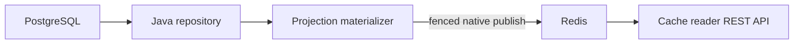

# rest-sample-cache-writer

## 0.8.1 Sürümü

Bu kaynak ağacı REST/platform 4.8.1, cache 0.9.1 ve model 0.5.1 kullanır. ARM manifesti
düzeltmesini içerir. İş kodu ve native ABI'ler değişmez.
Önceki 0.8.0 sürüm notları tarihsel kayıttır.
[Düzeltme notları](docs/RELEASE_NOTES_v0.8.1.tr.md).

[English](README.md) | [Türkçe](README.tr.md)

## 0.8.1 İle Başlayın

Projection işleri, hazırlanmış JSON alan adlarını ve sınırlı JDBC/Redis işlemlerini kullanır. Projection bazlı zamanlama, kilit, fencing ve TTL koruması korunur. Writer, veritabanından Redis'e yayın yapar; REST okuma yapmaz.

[Kullanım rehberi](docs/functional-operations.tr.md) · [Sürüm notları](docs/RELEASE_NOTES_v0.8.1.tr.md)


Özellik, çalıştırma ve hata eşleştirmesi: [Kullanım örnekleri](docs/functional-operations.tr.md).

PostgreSQL verisini okuyup Redis'e hazır JSON snapshot'ları yazan küçük bir scheduler uygulamasıdır.

- SQL, iş dönüşümü ve scheduler kararları Java'da kalır.
- Redis I/O işlemlerini `java-rust-cache` üzerinden Rust yapar.
- Uygulama REST API açmaz.
- Uygulama Dubbo kullanmaz.
- Her projection'ın kendi çalışma aralığı, TTL değeri ve distributed lock'u vardır.

Kullanılan sürümler: `rust-java-platform-parent:4.8.1`, `java-rust-cache:0.9.1`, `rust-sample-model:0.5.1`.

## Önce Bu Bölümü Okuyun

PostgreSQL verisini Redis'e hazırlama sorumluluğu tek bir scheduler process'inde olacaksa bu sample
doğru başlangıçtır. Ayrı ve ölçülmüş bir sorumluluk yoksa bu process'e REST server veya Redis read
plane eklemeyin.

| Hedef | Bölüm |
| --- | --- |
| PostgreSQL, Redis ve tek publish çalıştırmak | [Hızlı Başlangıç](#hızlı-başlangıç) |
| TTL, refresh ve lock güvenliğini anlamak | [Çalışma Aralığı, TTL ve Kilit](#çalışma-aralığı-ttl-ve-kilit) |
| Standalone, Sentinel veya Cluster seçmek | [Redis Çalışma Biçimini Seçin](#redis-çalışma-biçimini-seçin) |
| Birden fazla replica çalıştırmak | [Birden Fazla Replica](#birden-fazla-replica) |
| Agent desteğinin sınırını anlamak | [Glowroot Agent Kullanımı](#glowroot-agent-kullanımı) |

POM, `rust-java-platform-parent` ve tek bir `rust-java-starter-cache-writer` bağımlılığı kullanır.
Bu starter scheduler process'ine REST runtime eklemez. Kod üreteçleri yalnız derleyici yolunda kalır
ve production sınıfı olarak pakete girmez.

## Güncel Kaynak Ayarları

Bu güncelleme, platformu REST `4.8.1` ve isteğe bağlı agent `0.7.1` ile eşler.
Seçtiğiniz bağımlılığın native dosyasını kullanın. Eski SO/DLL dosyalarını karıştırmayın.
İş kodu, URL'ler ve ayar anahtarları değişmez. Telemetri varsayılan olarak kapalıdır.
HTTP micro bellek testi, veritabanı işinde veya daha ayrıntılı profilde aynı maliyeti garanti etmez.

`0.8.1` sürümü platform parent `4.8.1` kullanır. Uygulamayı hizalanmış bağımlılıklarla
yeniden derleyin. [Sürüm notlarını](docs/RELEASE_NOTES_v0.8.1.tr.md) okuyun. Runtime ayarları ve adresler değişmez.

- Managed writer launcher PostgreSQL kaynağını tek lifecycle içinde oluşturur ve kapatır.
- Generated projection registry bağlantısı tekrar eden projection lookup kodunu kaldırır.
- SQL sorguları ve JSON business mapping açık Java kodu olarak kalır.
- Projection adları, yenileme aralıkları, TTL kuralları, lock'lar ve Redis key'leri değişmedi.
- Cache writer, Redis ABI `6` ve pakete ait SHA-256 bilgisini doğrular. REST runtime başlatmaz.

## Deklaratif Akış

| Sizin yazdığınız kod | Framework'ün ürettiği veya yönettiği alan | Bu process'te hiç açılmayan alan |
| --- | --- | --- |
| SQL ve batch repository | Repository lifecycle ve shutdown sırası | REST server |
| Projection materializer | Projection registry ve schedule'lar | Redis read pool |
| JSON business şekli | Bounded publish pipeline | Dubbo runtime |
| Projection bazlı interval, TTL ve lock | Scheduler ve fenced lock sahipliği | Tekrar eden schedule bağlantı kodu |

Framework lifecycle ve registry boilerplate kodunu kaldırır. SQL, veri seçimi ve JSON business şekli
açık Java kodu olarak kalır. Böylece cache sözleşmesi kolayca incelenebilir.

## Buradan Başlayın

REST pod'larının her istekte PostgreSQL'e gitmesini istemiyorsanız bu sample'ı kullanın.

Projection, belirli bir endpoint grubu için hazırlanmış cache görünümüdür. Müşteri detayı ve kampanya adayları iki ayrı projection örneğidir.

```text
PostgreSQL -> bu writer -> Redis -> cache reader -> HTTP istemcisi
```



## Hızlı Başlangıç

### 1. PostgreSQL ve Redis'i başlatın

PowerShell'de çalıştırın:

```powershell
docker rm -f rs-cache-postgres-test rs-cache-redis-test 2>$null

docker run -d --name rs-cache-postgres-test `
  -e POSTGRES_DB=reactor_sample `
  -e POSTGRES_USER=reactor `
  -e POSTGRES_PASSWORD=reactor `
  -p 15432:5432 postgres:15.7-alpine

docker run -d --name rs-cache-redis-test `
  -p 16379:6379 redis:8.2.1-alpine3.22
```

### 2. Tek snapshot yayınlayın

Bu repo dizininde çalıştırın:

```powershell
$env:GITHUB_PACKAGES_TOKEN="READ_PACKAGES_YETKILI_TOKEN"

mvn -q `
  "-Dsample.writer.run-once=true" `
  "-Dsample.writer.initial-delay-ms=0" `
  "-Dsample.db.jdbc-url=jdbc:postgresql://127.0.0.1:15432/reactor_sample" `
  "-Dsample.db.username=reactor" `
  "-Dsample.db.password=reactor" `
  "-Dreactor.cache.redis.host=127.0.0.1" `
  "-Dreactor.cache.redis.port=16379" `
  clean compile exec:java
```

Beklenen log:

```text
cache refresh published projection=detail version=<version> keys=<count>
```

### 3. Veriyi okuyun

[`rest-sample-cache-reader`](https://github.com/esasmer-dou/rest-sample-cache-reader) uygulamasını başlatın. Reader aynı Redis'e bağlanır.

## Hangi Veriler Yazılır?

| Projection | Varsayılan namespace | Kullanım amacı |
|---|---|---|
| `detail` | `crm.customer.detail` | Müşteri profili |
| `segment` | `crm.customer.segment` | Segmentteki müşteriler |
| `status` | `crm.customer.status` | Aktif veya pasif müşteri listesi |
| `campaign` | `crm.customer.campaign` | Kampanya adayları |
| `meta` | `crm.customer.meta` | Snapshot durumu ve sürümü |

Yalnızca ihtiyacınız olan projection'ları açın:

```properties
sample.writer.projections=detail,segment,status,campaign,meta
```

Yalnızca kampanya verisi üreten bir uygulama şu ayarı kullanabilir:

```properties
sample.writer.projections=campaign,meta
```

## Çalışma Aralığı, TTL ve Kilit

Yayımlanmış sample `0.8.0`, cache `0.9.0` ile
`reactor.cache.redis.snapshot-batch-enabled=true` ayarını kullanır.
Kütüphanenin kendi varsayılanı kapalı kalır. Uygun native dosya ile
standalone Redis ve Sentinel'de küçük bir yenileme iki Redis yazma çağrısıyla
tamamlanır. İlk çağrı kilidi ve fencing token'ı alır. İkinci çağrı son veri
partisini yazar, sürümü yayınlar ve kilidi bırakır. Cluster mevcut slot uyumlu
yolu kullanır. Eski native dosyalarda da mevcut yol çalışmaya devam eder.
Anahtarlar, TTL, kilit sahibi ve fencing kontrolleri korunur. Büyük snapshot'lar
sınırlı partilerle yazılır. Son parti 1 MiB'ı aşarsa normal toplu yazma kullanılır.
Yayın anında Redis'teki kilit sahibi kontrol edilir. Yalnız yerel bir işarete
güvenilmez. Sonucu belirsiz ağ hataları sessizce tekrarlanmaz. Ek worker veya
bellekte tutulan payload havuzu eklenmez.

Eski yayın yolunu seçmek için `REACTOR_CACHE_REDIS_SNAPSHOT_BATCH_ENABLED=false`
verin. SQL okumaları ve yayınlanan JSON değişmez. Küçük bir yenileme için iki
yerine beş Redis yazma çağrısı yapılır. Kendi ortamınızda işin toplam süresini
ölçün. Çağrı sayısının azalması, belirli bir p99 değerini garanti etmez.

Uyumlu native kütüphane bu iki sabit Lua programını `EVALSHA` ile çağırır. Redis'te
saklanan şey programdır; müşteri verisi veya SQL sonucu değildir. Program
bulunamazsa bir kez `EVAL` gönderilir. Sonraki çağrılar programın özetini taşır.
Redis, `EVALSHA` komutuna izin vermiyorsa mevcut `EVAL` yolu korunur. Timeout
ve Lua çalışma hataları yeniden denenmez. Cache metriklerindeki
`snapshot_script_cache_misses` ve `snapshot_script_acl_fallbacks` bu durumları
gösterir. Gönderilen byte sayısına ek ilk çağrılar da dahildir. `write_calls`
iki mantıksal yazma işlemini sayar; script cache için ek ağ çağrılarını saymaz.


`meta` projection'ı sayıları, segment adlarını ve durum adlarını tek SQL sorgusunda
okur. Bu üç bilgi aynı veritabanı görünümünden gelir. Segment sınırı 64, durum
sınırı 32 olarak kalır. Boş adlar bu sınırlar uygulandıktan sonra çıkarılır.
JDBC dizileri ve bağlantı okuma sonunda bırakılır. Ek pool, thread, cache veya
property gerekmez. Redis kilidi ve fencing kontrolleri korunur. Azalan şey
veritabanına gidiş geliş sayısıdır; tutarlılık kontrolü değildir.

Segment ve durum yenilemesi, her projection için sınırlı bir gruplu sorgu kullanır.
Kaynak kodda, tamamı en fazla 64 satır olan sonuç tek autocommit SELECT ile okunur.
Daha büyük sonuçlarda sınırlı ön okumanın ardından mevcut DB cursor'ı kullanılır.
Sorgu hem grup sayısını hem de grup başına müşteri sayısını sınırlar.
Yalnız o anda yazılan grup Java nesnelerine dönüştürülür. Her segment veya durum için
ayrı sorgu çalıştırılmaz. Detay yenilemesi, ID üzerinden sayfalama yapmaya devam eder.
JSON biçimi, TTL, replica kilitleri ve snapshot'ın atomik yayını değişmez.

Her projection bağımsız çalışır.

```properties
sample.writer.campaign.interval-ms=30000
sample.writer.campaign.cache-ttl-ms=120000
sample.writer.campaign.lock-name=crm.customer.campaign.refresh
sample.writer.campaign.lock-ttl-ms=120000
```

Bu ayarlar şu anlama gelir:

1. Varsayılan fixed-delay zamanlamada sonraki kampanya denemesi, iş bitiminden 30 saniye sonra başlar.
2. Redis verisinin TTL'i 120 saniyedir; bu değer reader tazelik sınırı değildir.
3. Yayını 120 saniyelik Redis kilidi korur; eski writer için sahiplik/fencing kontrolü yapılır.
4. Başka bir replica farklı bir projection'ı aynı anda yenileyebilir.

Cache TTL değerini çalışma aralığı, beklenen hazırlama/kesinti süresi ve güvenlik
payından uzun tutun. Yalnız interval'e eşit/kısa TTL, interval +
`sample.writer.cache-ttl-safety-margin-ms` değerine çıkarılıp loglanır; bu alt sınır kesinti garantisi değildir.
Lock TTL ayrıdır; işin zaman aşımı değildir. Tüm yenileme ve ağ payını kapsamalıdır.
Kilidi dolan iş hesaplamaya devam edebilir; eski kilitle yayın yapamaz.

## Redis Çalışma Biçimini Seçin

| Ortam | Ayar |
|---|---|
| Lokal Redis | `reactor.cache.redis.topology=standalone` |
| Redis Sentinel | `reactor.cache.redis.topology=sentinel`, Sentinel node'ları ve master adı |
| Redis Cluster | `reactor.cache.redis.topology=cluster` ve cluster node'ları |

Writer bilinçli olarak yalnızca yazma yapar:

```properties
reactor.cache.redis.access-mode=write-only
```

## Küçük Linux/OpenJ9 Podları

Linux/OpenJ9 ortamında `-XX:-TransparentHugePage` seçeneğini deneyebilirsiniz.
Consumer'da yarar sağlayan bir ayarı writer'a ölçmeden taşımayın.
Writer'ın derleme ve yenileme yükü farklıdır. Bu seçenek tepe RSS değerini de
artırabilir. Yalnız tekrarlı yenileme testlerinde yarar görürseniz kullanın.
Bu seçenek sample image'ında varsayılan olarak açık değildir. Etkinleştirdiğinizde
OpenJ9, ayırdığı bellek için Linux'tan otomatik büyük sayfa istemez.
Heap limitini düşürmeden ve JIT'i kapatmadan
fiziksel bellek kullanımını azaltabilir. Bu seçenek bir heap limiti değildir.
Sunucunun genel ayarını değiştirmez. Native alanlar yine büyük sayfa kullanabilir.

`JAVA_TOOL_OPTIONS` verirseniz image'daki değerin tamamını değiştirirsiniz.
Mevcut küçük pod image'ı için seçenekleri birlikte koruyun:

```yaml
env:
  - name: JAVA_TOOL_OPTIONS
    value: >-
      -Xms24m -Xmx96m -Xss192k -Xgc:threads=1
      -XX:ActiveProcessorCount=1 -Xtune:virtualized -XX:-TransparentHugePage
```

Bu reçete OpenJ9 içindir. Scheduler thread'leri, yenileme aralığı, Redis batch
boyutu, TTL ve Hikari limitleri değişmez. Aynı sayıda başarılı yenileme için süreyi
ve RSS'i karşılaştırın. Yayınlama yavaşlıyorsa veya yenileme aralığını kaçırıyorsa
tek başına düşük RSS yeterli değildir.

## Konfigürasyon

Uygulama ayarları şu sırayla okur:

1. `src/main/resources/rest-sample-cache-writer.properties`
2. `reactor.config.file` veya `REACTOR_CONFIG_FILE` ile verilen dosyalar
3. JVM `-D...` değerleri ve desteklenen environment variable'lar

| Dosya | Amacı |
|---|---|
| `rest-sample-cache-writer.properties` | Lokal DB, scheduler, projection, lock ve Redis ayarları |
| `config/production.properties` | Production HikariCP limitleri, TTL değerleri ve Redis timeout'ları |
| `config/advanced-tuning.properties` | Daha büyük batch, projection'a özel lock ve Redis pipeline ayarları |

Production ayarlarını şu şekilde ekleyin:

```powershell
java "-Dreactor.config.file=src/main/resources/config/production.properties" ...
```

Önerilen başlangıç değerleri:

| Property | Başlangıç | Ne zaman değiştirilir? |
|---|---:|---|
| `sample.db.maximum-pool-size` | `2` | DB bekleme süresi yüksekse ve PostgreSQL kapasitesi varsa |
| `sample.writer.scheduler-threads` | `2` | Bağımsız projection'lar zamanında bitmiyorsa |
| `sample.writer.page-size` | `500` | Veritabanı gecikmesi ve heap ölçüldükten sonra |
| `reactor.cache.redis.write-connections` | `2` | Ölçülen darboğaz Redis yazma kuyruğuysa |
| `reactor.cache.redis.max-write-inflight` | `4` | Redis kapasitesi ölçümle doğrulandıysa |

Bütün limitleri aynı anda artırmayın. Bu yaklaşım gerçek darboğazı gizler ve process memory (RSS) değerini yükseltir.

## Glowroot Agent Kullanımı

Varsayılan derleme agent bağımlılığı eklemez. İş mantığı ve mevcut ayarlar değişmez.
Telemetri gerekiyorsa `glowroot` Maven profilini seçin.

```powershell
$env:REACTOR_GLOWROOT_ENABLED="true"
$env:REACTOR_GLOWROOT_PROFILE="micro"
$env:REACTOR_GLOWROOT_COLLECTOR_ADDRESS="http://127.0.0.1:8181"
$env:REACTOR_GLOWROOT_AGENT_ID="cache-writer-local"
mvn -Pglowroot clean compile exec:java
```

Profil, `java-rust-glowroot-cache-adapter:0.7.1` paketini ekler.
`TelemetryCacheWriterApplication` mevcut writer yaşam döngüsünü kullanır. Projection adları ayarlardan alınır. Collector UI'da `Scheduler` türünü ve `cache-refresh:<projection>` adını seçin.

Spring veya REST sunucusu eklenmez. Agent açıksa izole Rust exporter çalışır.
Yeni Java executor oluşturulmaz. Payload, SQL değeri veya müşteri bilgisi gönderilmez.
Normal kilit atlaması hata değildir. Başarısız sonuç ve exception hata sayılır. Yazma işlemi yeniden denenmez.

`REACTOR_GLOWROOT_ENABLED=false` ile agent'ı kapatın.
Bağımlılığı da çıkarmak için `glowroot` profilini seçmeden derleyin.
Bootstrap JAR'ını tek başına eklemek bu yaşam döngüsünü başlatmaz.

Maven `settings.xml` dosyasına `github-glowroot` kimlikli server ekleyin.
Geçerli `read:packages` token'ı kullanın. SSH Maven paketlerini indirmez.
`micro` ile başlayın. HTTP testindeki 3 MiB boşta medyan sınırı, bu uygulamanın
her iş yükünde aynı maliyetle çalışacağının garantisi değildir.

[Kurulum ve profil ayrıntıları](https://github.com/esasmer-dou/java-rust-glowroot-agent/blob/v0.7.1/docs/functional-operations.tr.md)

## Birden Fazla Replica

Birden fazla replica güvenle çalışabilir.

- Scheduler bu process içinde aynı projection'ın zamanlanmış işlerini üst üste çalıştırmaz; replica'ları Redis kilidi koordine eder.
- Yayında güncel kilit sahibi/fencing token kontrol edilir. Kilit süresi dolarsa hesaplamalar çakışabilir; eski writer'a yayın yetkisi verilmez.
- Farklı projection'lar scheduler ve bağlantı sınırları içinde eşzamanlı çalışabilir.
- Normal bitiş kilidi erken bırakır. Çökme sonrasında başka replica, süre dolduktan sonraki denemesinde kilidi alabilir.

Her projection için sabit ve farklı `lock-name` kullanın; aynı projection'ın tüm
replica'larında bu ad aynı olmalıdır. Reader ve writer projection namespace'leri de eşleşmelidir.

## Kod Haritası

| Dosya | Görevi |
|---|---|
| `RestSampleCacheWriterApplication.java` | Projection scheduler'ını başlatır |
| `CustomerCacheMaterializer.java` | Projection refresher'ı uygular; generated registry her projection'ı bağlar |
| `PostgresCustomerRepository.java` | SQL ve database paging işlemlerini yönetir |
| `CustomerJsonWriter.java` | Ek Java nesne ağacı oluşturmadan JSON yazar |
| `rest-sample-cache-writer.properties` | Lokal ayarları taşır |

Uygulama, dört parametreli managed `ProjectionWriterApplication.runCache(...)` metodunu kullanır.
İki method reference repository ve materializer oluşturur. Redis, scheduler, repository ve kapanış
sırası library tarafından yönetilir. SQL sorguları ve JSON business şekli açık Java kodu olarak kalır.

## Maven Package Erişimi

GitHub Packages için `read:packages` yetkili token gerekir. Token'ın private `rust-sample-model` reposuna da erişimi olmalıdır.

Şu server kimliklerini `~/.m2/settings.xml` dosyasına ekleyin:

```xml
<servers>
  <server>
    <id>github</id>
    <username>GITHUB_KULLANICI_ADI</username>
    <password>${env.GITHUB_PACKAGES_TOKEN}</password>
  </server>
  <server>
    <id>github-rust-sample-model</id>
    <username>GITHUB_KULLANICI_ADI</username>
    <password>${env.GITHUB_PACKAGES_TOKEN}</password>
  </server>
</servers>
```

## Sık Karşılaşılan Sorunlar

| Belirti | Kontrol edin |
|---|---|
| Maven `401` dönüyor | Token, private repo erişimi ve server kimlikleri |
| Writer PostgreSQL'e bağlanamıyor | JDBC URL, port, kullanıcı adı ve parola |
| Reader eski veya eksik veri görüyor | Projection namespace, interval, TTL ve writer logları |
| İki replica aynı veriyi yazıyor | Projection lock adları bütün replica'larda aynı olmalı |
| Redis memory hızlı büyüyor | Saklanan sürüm, TTL, index limiti ve aktif veri grubu sayısı |
| `reactor.glowroot.enabled=true` yazdım ama veri yok | `-Pglowroot` ile derleyip çalıştırın; `TelemetryCacheWriterApplication` ve cache adaptörü gerekir. Collector/agent ID ayarını kontrol edin. Bu HTTP sunucusu olmayan process'te REST diagnostics endpoint'i yoktur |

## Production Kontrol Listesi

- `reactor.cache.redis.access-mode=write-only` değerini koruyun.
- Her TTL değerini ilgili projection yenileme aralığından uzun tutun.
- Bağımsız çalışan her projection için sabit ve farklı lock adı kullanın.
- SQL paging ve batch size değerlerini sınırlayın. Kaynak tablonun tamamını tek listeye almayın.
- Hikari connection sayısını scheduler thread sayısına göre değil, veritabanı kapasitesine göre belirleyin.
- Publish işlemini idempotent yapın. Aktif snapshot sürümünü değiştirmeden önce fenced ownership kullanın.
- İki replica, lock devri, Redis restart/failover, DB timeout, yarım kalan publish ve recovery testi yapın.
- Publish süresi, schedule gecikmesi, DB pool wait, Redis p99, RSS ve saklanan sürümleri ölçün.
- Yalnız telemetri için Spring Boot veya REST runtime eklemeyin.

## Sık Yenilemelerde Başlangıç Aralığını Koruyun

Kaynak koddaki repository, segment ve durum sorguları için sınırlı bir plan
tanımlar. Sonucun tamamı en fazla 64 satırsa tek autocommit SELECT kullanılır.
Daha büyük sonuçlarda mevcut streaming cursor çalışır. Probe satırları
yayımlanmaz veya cursor'ın veri grubuna eklenmez. Veritabanı sonucu cache'lenmez.
Sınır aşılırsa bir ek sınırlı okuma yapılır. Sonuçlarınız genellikle büyükse
`forEachQueryGroup` metodunun String SQL alan önceki overload'unu kullanın.
Doğrulama, JSON üretimi ve Redis fencing kontrolü Java'da kalır.

Kısa interval kullanıyorsanız `sample.writer.phase-anchored=true` seçeneği,
projection'ların başlangıç aralığını korur. Varsayılan `false`, her iş bittikten
sonra tam interval bekler. İş süreleri farklıysa projection'lar zamanla aynı ana kayabilir.

```properties
sample.writer.phase-anchored=true
sample.writer.interval-ms=500
sample.writer.detail.initial-delay-ms=2000
sample.writer.segment.initial-delay-ms=2100
sample.writer.status.initial-delay-ms=2200
sample.writer.campaign.initial-delay-ms=2300
sample.writer.meta.initial-delay-ms=2400
```

Kaçırılan zaman dilimleri peş peşe çalıştırılmaz. Mevcut thread sınırı ve projection
kilitleri korunur. Ek thread veya kuyruk açılmaz. TTL; interval, beklenen iş/kesinti
süresi ve güvenlik payının toplamından uzun olmalıdır. İş bittikten sonra tam bir
dinlenme aralığı gerekiyorsa varsayılanı koruyun. Bu seçenek yalnız zamanlamayı
değiştirir. DB satırları, JSON içeriği ve yayın tutarlılığı değişmez.

Bu isteğe bağlı seçenek p99 düzeltmesi veya yeni production varsayılanı değildir.
Açmadan önce işin çalışma süresini ayrıca ölçün.

## Kısa Sözlük

| Terim | Basit anlamı |
| --- | --- |
| Projection | Bir endpoint veya sorgu ailesi için hazırlanmış cache görünümü |
| Refresh interval | Projection'ın ne sıklıkla yeniden üretildiği |
| TTL | Yeni başarılı refresh olmadan verinin Redis'te kalacağı süre |
| Fenced lock | Eski replica'nın publish yapmasını engelleyen ownership kontrollü kilit |
| Active version | Reader'ın o anda çözdüğü snapshot sürümü |
| Materializer | Kaynak satırları okuyup cache gösterimini üreten Java kodu |
| Bootstrap agent JAR | Yalnız `-javaagent` argümanlarını property'lere çeviren, runtime içermeyen küçük JAR |

## Ayrıntılı Bilgi

- [Türkçe kullanıcı rehberi](docs/USER_GUIDE.tr.md)
- [Türkçe PDF rehberi](docs/rest-sample-cache-writer-user-guide.tr.pdf) (önceki kopya; bu düzeltmeler için Markdown'ı kullanın)
- [Production ayarları](src/main/resources/config/production.properties)
- [Advanced tuning ayarları](src/main/resources/config/advanced-tuning.properties)
- [v0.8.0 sürüm notları](docs/RELEASE_NOTES_v0.8.0.tr.md)
- [Henüz yayımlanmamış belge düzeltmeleri](docs/RELEASE_NOTES_UNRELEASED.tr.md)
