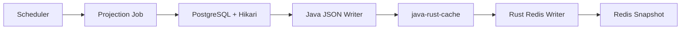
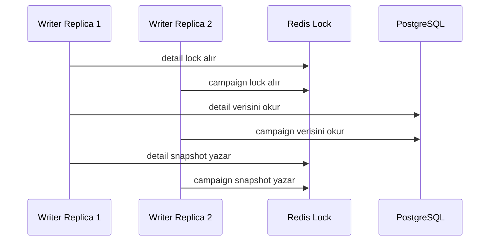

# rest-sample-cache-writer Kullanıcı Rehberi

Bu rehber sample `0.8.0` / cache `0.9.0` ile ilk kullanım içindir.
Özellik, batch ve telemetri eşleştirmesi için [güncel kullanım tablosuna](functional-operations.tr.md) bakın.

Amaç kısa ve nettir: PostgreSQL'den veriyi okuyup Redis'e hazır JSON snapshot olarak yazmak.

## İçindekiler

1. [Bu Proje Ne İşe Yarar?](#bu-proje-ne-işe-yarar)
2. [Akış Nasıl Çalışır?](#akış-nasıl-çalışır)
3. [Ne Zaman Kullanılır?](#ne-zaman-kullanılır)
4. [Gerçek Hayat Senaryoları](#gerçek-hayat-senaryoları)
5. [Hızlı Başlangıç](#hızlı-başlangıç)
6. [Kopyala-Yapıştır Örnekler](#kopyala-yapıştır-örnekler)
7. [Projection Mantığı](#projection-mantığı)
8. [Önemli Ayarlar](#önemli-ayarlar)
9. [TTL Ve Refresh Kuralı](#ttl-ve-refresh-kuralı)
10. [İki Replica Nasıl Davranır?](#iki-replica-nasıl-davranır)
11. [Sık Hatalar](#sık-hatalar)

## Bu Proje Ne İşe Yarar?

`rest-sample-cache-writer`, DB verisini Redis read model'e çeviren örnektir.

REST endpoint açmaz. Dubbo kullanmaz.

DB okuma Java tarafındadır. Redis yazma `java-rust-cache` ile Rust tarafındadır.

## Akış Nasıl Çalışır?



Writer snapshot üretir. Reader bu snapshot'ı okur.

Bu ayrım read-heavy sistemlerde DB'yi hot path dışına çıkarır.

## Ne Zaman Kullanılır?

| Senaryo | Bu proje uygun mu? | Neden |
|---------|--------------------|-------|
| DB'den read model üretilecek | Evet | Projection bazlı snapshot yazar. |
| REST API açılacak | Hayır | Bu proje HTTP server değildir. |
| Çok replica çalışacak | Evet | Projection bazlı lock vardır. |
| Her request'te DB query isteniyor | Hayır | Bu proje cache materializer'dır. |
| Redis Cluster veya Sentinel kullanılacak | Evet | `java-rust-cache` destekler. |

## Gerçek Hayat Senaryoları

| Senaryo | Ne yapılır? | Önerilen projection |
|---------|-------------|---------------------|
| Müşteri detay ekranı | Her müşteri için hazır JSON yazılır. | `detail` |
| Segment listesi | Segment bazlı index yazılır. | `segment` |
| Aktif müşteri ekranı | Status bazlı index yazılır. | `status` |
| Kampanya seçimi | Sık değişen aday listesi kısa aralıkla yenilenir. | `campaign` |
| Cache sağlık bilgisi | Son snapshot zamanı ve sayaçlar yazılır. | `meta` |

Bu projede amaç API request anında DB yükünü azaltmaktır.

Writer DB'yi kontrollü aralıklarla okur. Reader ise Redis'ten hızlı cevap verir.

## Hızlı Başlangıç

PostgreSQL ve Redis'i hazırlayın.

Sonra writer'ı çalıştırın:

```powershell
mvn -q package
mvn -q exec:java
```

Tek seferlik snapshot için:

```powershell
mvn -q -Dsample.writer.run-once=true exec:java
```

Üretilen ince JAR yalnızca uygulama sınıflarını içerir. Doğrudan `java -jar` yerine
yukarıdaki Maven komutunu kullanın.

## Kopyala-Yapıştır Örnekler

Sadece tek seferlik snapshot üret:

```powershell
mvn -q "-Dsample.writer.run-once=true" `
  "-Dsample.writer.projections=detail,segment,meta" `
  exec:java
```

Kampanya projection'ını daha sık yenile:

```properties
sample.writer.campaign.interval-ms=30000
sample.writer.campaign.cache-ttl-ms=120000
```

Segment ve status projection'larını daha seyrek yenile:

```properties
sample.writer.segment.interval-ms=120000
sample.writer.segment.cache-ttl-ms=300000
sample.writer.status.interval-ms=120000
sample.writer.status.cache-ttl-ms=300000
```

Production'da schema init kapat:

```properties
sample.db.schema-init=false
sample.db.maximum-pool-size=2
sample.db.minimum-idle=0
```

Redis Sentinel örneği:

```properties
reactor.cache.redis.topology=sentinel
reactor.cache.redis.nodes=redis-sentinel-0.redis:26379,redis-sentinel-1.redis:26379,redis-sentinel-2.redis:26379
reactor.cache.redis.sentinel.master-name=mymaster
```

## Projection Mantığı

Projection, Redis'e yazılan ayrı bir read model parçasıdır.

| Projection | Ne üretir? | Örnek kullanım |
|------------|------------|----------------|
| `detail` | Customer detail ve customerNo index | `GET /customers/{id}` |
| `segment` | Segment bazlı liste | Segment ekranı |
| `status` | Status bazlı liste | Aktif/pasif müşteri ekranı |
| `campaign` | Kampanya aday listesi | Kampanya seçimi |
| `meta` | Snapshot bilgisi | Cache hazır mı kontrolü |

Her projection kendi interval, TTL ve lock değerine sahip olabilir.

## Önemli Ayarlar

| Property | Ne işe yarar? | Ne zaman değiştirilir? |
|----------|---------------|------------------------|
| `sample.writer.projections=detail,segment,status,campaign,meta` | Çalışacak projection listesidir. | Sadece ihtiyacınız olan read model'leri bırakın. |
| `sample.writer.interval-ms=60000` | Varsayılan fixed-delay modda iş bittikten sonraki bekleme süresidir. | Projection'a özel değer yoksa kullanılır. |
| `sample.writer.detail.interval-ms` | Sadece `detail` projection aralığıdır. | Projection bazlı zamanlama istiyorsanız kullanın. |
| `sample.writer.detail.cache-ttl-ms` | `detail` verisinin Redis TTL değeridir. | Her zaman interval değerinden uzun olmalıdır. |
| `sample.writer.scheduler-threads=2` | Aynı anda kaç projection job çalışabilir. | Replica ve DB kapasitesine göre küçük tutun. |
| `sample.writer.lock-ttl-ms=300000` | Redis lock yaşam süresidir; job timeout'u değildir. | Tam yenileme süresi ve ağ payını kapsamalıdır. |
| `sample.db.maximum-pool-size=2` | Production ayar dosyasındaki Hikari DB connection üst limitidir. | DB kapasitesi ölçülmeden artırılmamalıdır. |

Temel dosyada `sample.writer.snapshot-batch-size=256` ve `sample.writer.page-size=500`
kullanılır; advanced dosyada bunlar `512` / `1000` olur. İlki Redis kayıt, ikincisi DB
satır sınırıdır; aynı anlama gelmez. [Batch tablosu](functional-operations.tr.md#batch-ayarları-ve-yayın)
pipeline sınırını da ayırır. Hiçbiri async snapshot kuyruğu açmaz.

## TTL Ve Refresh Kuralı

TTL, refresh interval yanında hazırlama süresi, beklenen kesinti ve güvenlik payını da kapsamalıdır.

| Örnek | Doğru mu? | Neden |
|-------|-----------|-------|
| `interval=60000`, `ttl=300000` | Başlangıç reçetesi | Sağlıklı yenileme için pencere bırakır; iş/kesinti süresi ayrıca ölçülür. |
| `interval=120000`, `ttl=60000` | Hayır | Reader kısa süre cache miss görebilir. |
| `campaign interval=30000`, `ttl=120000` | Başlangıç reçetesi | Kısa yenileme için pay bırakır; kesintiye dayanıklılık garantisi değildir. |

Production payını açıkça planlayın:

```text
cache-ttl-ms > interval-ms + hazırlama/kesinti bütçesi + güvenlik payı
```

Kütüphane yalnız interval'e eşit/kısa TTL'i interval +
`sample.writer.cache-ttl-safety-margin-ms` değerine çıkarır. Bu asgari düzeltme üretim
kesinti bütçesinin yerine geçmez. Redis TTL, reader'ın
isteğe bağlı `max-age-ms` tazelik sınırından ve lock TTL'den ayrıdır.

## İki Replica Nasıl Davranır?



Scheduler aynı process içinde bir projection'ın zamanlanmış işlerini çakıştırmaz.
Replica'lar Redis kilidiyle koordine edilir; yayında sahiplik/fencing doğrulanır.
Lock TTL dolunca eski iş hesaplamaya devam edebilir, fakat eski kilitle yayın yapamaz.

Farklı projection'lar aynı anda farklı replica üzerinde çalışabilir.
Normal bitiş kilidi erken bırakır. Çöken process sonrasında kalan lock TTL dolmalı;
diğer replica ancak sonraki denemesinde kilidi alabilir. Aynı projection'ın namespace
ve lock adı replica'lar arasında aynı, farklı projection'ların lock adları ayrı olmalıdır.

## Sık Hatalar

| Belirti | Muhtemel neden | Çözüm |
|---------|----------------|-------|
| TTL uyarısı | TTL, interval değerinden kısa. | TTL değerini interval değerinden uzun yapın. |
| Lock alınamadı | Başka replica aynı projection'ı yazıyor. | Bu normaldir. Logları kontrol edin. |
| Yayında kilit/fencing hatası | İş lock TTL'i aşmış veya sahiplik değişmiş. | İş süresini/lock TTL'i ölçün; sonucu belirsiz yazmayı körlemesine tekrarlamayın. |
| DB yavaşlıyor | Scheduler thread veya Hikari pool fazla. | `scheduler-threads` ve `maximum-pool-size` düşürün. |
| Reader `customer_cache_not_ready` dönüyor | Writer henüz snapshot yazmadı. | Writer loglarında projection publish satırlarını kontrol edin. |
| Glowroot verisi yok | Yalnız enabled ayarı verilmiş veya collector hatalı. | [README komutuyla](../README.tr.md#glowroot-agent-kullanımı) `-Pglowroot` kullanın; writer'da REST diagnostics endpoint'i aramayın. |
